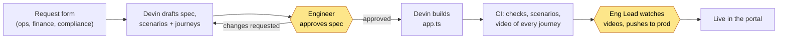
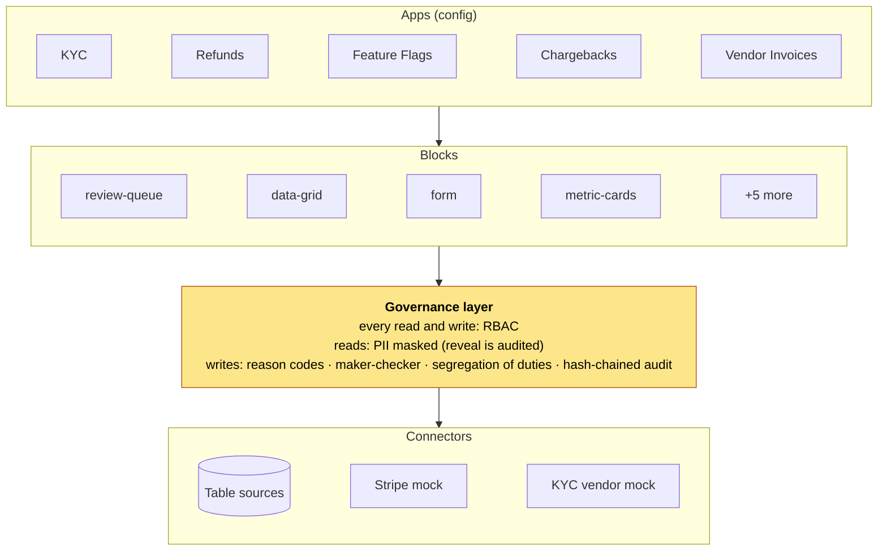
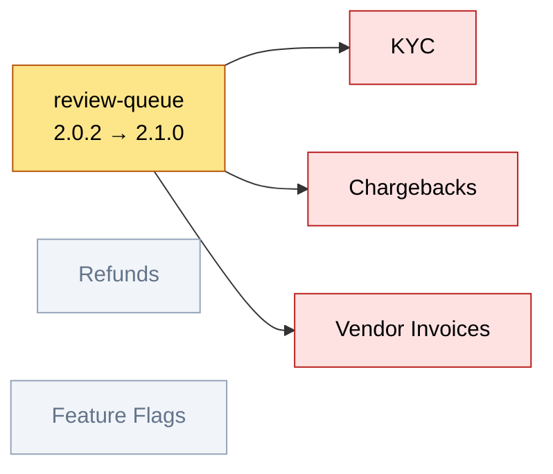

# Internal Tools on Devin — a Power Apps alternative (prototype)

A platform for a fintech's internal apps. Each app is mostly a short config file that combines reusable, versioned blocks; every app shares one governance layer for permissions, approvals, PII masking and audit. Devin builds new apps from plain-language requests, and engineers approve the spec and the finished app.

The question this prototype tests: **can you keep the speed and consistency of a shared platform without limiting what each app can do?**

## How an app gets built

Devin checks the block catalog for anything it can reuse, then drafts the spec. Requesters are never asked questions: Devin writes down its assumptions, and the engineer approves them at the first gate (see [decision 4](#4-engineers-stay-in-the-loop)).

## Four design decisions

### 1. Apps are configuration
An app is one `defineApp({...})` call: permissions, actions and pages made of blocks. Devin always takes the lowest rung of the **customization ladder** that works.

1. Configure an existing block
2. Compose blocks on a page
3. App-local handler (logic only this app needs)
4. New connector / data source
5. Extend a block with a new optional, backwards-compatible option
6. New block (via the [`create-block`](.agents/skills/create-block/SKILL.md) skill)

A need no block covers is built app-locally and logged in [`GAPS.md`](GAPS.md). When a **second** app needs it, or it is compliance-critical, it becomes shared.

### 2. Governance lives in one shared layer
Every mutation goes through one server-side pipeline in [`src/platform/actions.ts`](src/platform/actions.ts):
`RBAC → reason code → availability guard → idempotency → maker-checker → segregation of duties → execute → audit`.
Apps can't bypass it (`npm run boundaries` enforces the layering).


Reads are permission-checked and PII fields are masked unless a user with the right role reveals them, which is audited. The audit log is hash-chained, so tampering is detectable.

### 3. Blocks are versioned, with a dependency graph
Every block has a version, and [`module-graph.json`](module-graph.json) records which apps use which block versions. CI fails any PR that changes a block without bumping its version, and lists the affected apps. A fix is made once in the block, not copied between apps.



### 4. Engineers stay in the loop
Engineers sign off twice, both on the `/requests` dashboard:

1. **Before the build: approve the spec.** An engineer reads Devin's spec (assumptions, roles, pages, test journeys) and approves it or sends it back.
2. **Before production: approve the finished app.** CI runs the checks and records a video of every journey. An Eng Lead watches them and clicks Push to prod.

Devin never ships anything on its own.

## Repo map
| Layer | Path | What lives here |
|---|---|---|
| Platform | `src/platform/` | users/roles, RBAC, action pipeline, approvals, audit, PII, app schema, requests + GitHub |
| Connectors | `src/connectors/` | typed data sources with PII tags; mocked Stripe and KYC vendor |
| Blocks | `src/blocks/<name>/` | React component + `manifest.ts` (zod schema, version, use-when / not-for) |
| Apps | `src/apps/<slug>/` | `app.ts`, `scenarios.ts` (scenarios + journeys), `SPEC.md` |
| Portal | `src/app/` | gallery, app renderer, approvals, audit, module catalog, request form, requests dashboard |

Imports only flow downward. Rules for Devin and humans: [`AGENTS.md`](AGENTS.md). Devin's steps for building an app: [`build-internal-app`](.agents/skills/build-internal-app/SKILL.md).

## Run it
```bash
source ~/.nvm/nvm.sh   # Node >= 22.5 (uses node:sqlite)
npm install
npm run seed           # synthetic data only
npm run dev            # http://localhost:3000 — switch users via the MOCK SSO dropdown
```
Optional: set `GITHUB_TOKEN` + `GITHUB_REPO` (files an issue per request and powers the Requests dashboard) and/or `DEVIN_API_KEY` + `DEVIN_ORG_ID` (starts a Devin session per request via the v3 API; create the key under Settings > Devin API — a service user with `UseDevinSessions`, or a PAT). Without `DEVIN_ORG_ID` the legacy v1 endpoint is used.

## Checks
`npm run check` — typecheck, lint, layer boundaries, app config validation, `catalog.json` and `module-graph.json` freshness, unit tests (RBAC, maker-checker, idempotency, PII, audit tamper detection) and every app's scenarios.
`npm start & npm run smoke && npm run journeys` — page loads, then every journey in a real browser with a video each.

## What's mocked
Synthetic data only; mock SSO user switcher; Stripe and the KYC vendor are mocked; SQLite.
